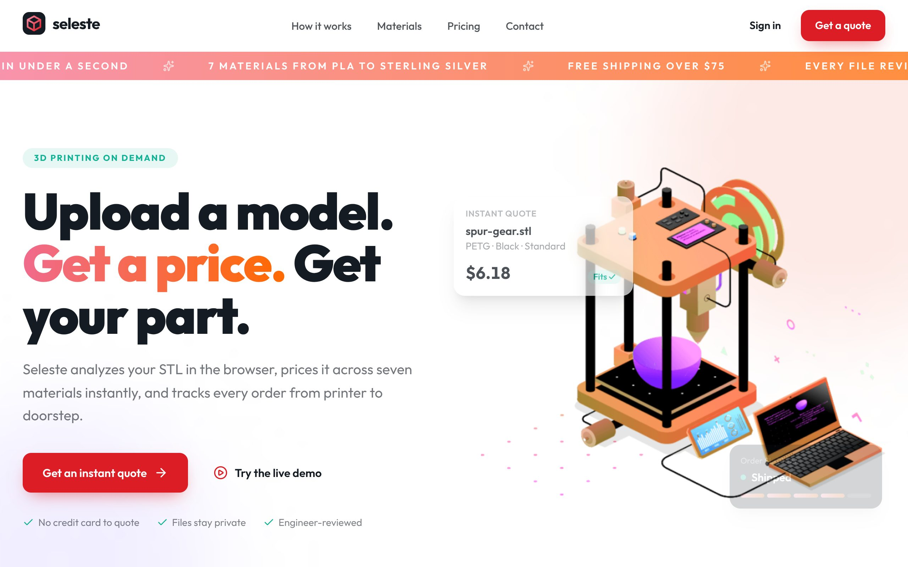
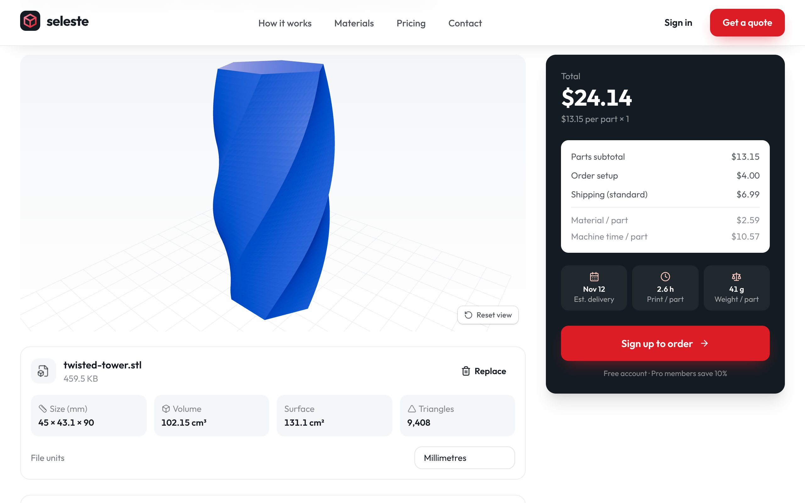
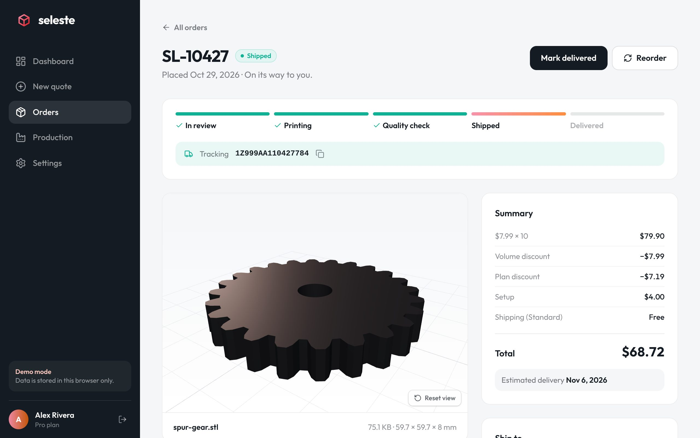
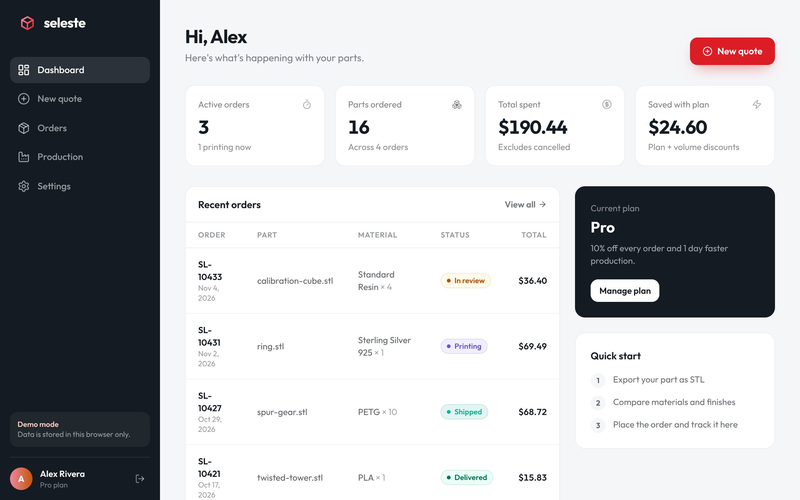
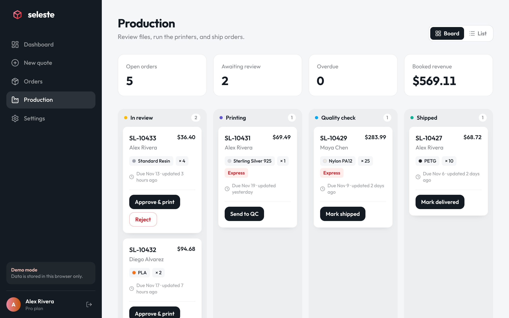

# Seleste

**Instant 3D-printing quotes and order management.** Upload an STL, see it in 3D, compare live prices across seven materials, place an order, and track it from engineer review to your door. Operators get a production board to run the queue.



## Features

- **In-browser STL analysis.** Binary and ASCII STL parsing with no dependencies. Exact volume (divergence theorem), surface area and bounding box. The file never leaves the browser until an order is placed.
- **Interactive 3D preview.** A three.js viewer with orbit controls, material-aware colours, and metal shading for DMLS and cast parts.
- **Transparent pricing engine.** Material usage accounts for FDM infill and shell thickness, plus machine time, finishing labour, minimum part charges, volume breaks, plan discounts and shipping. All money is integer cents, and every quote shows its breakdown and an estimated delivery date.
- **Printability checks.** Rejects parts that don't fit the build volume in any orientation, warns on features below the material minimum, and catches wrong-unit exports (mm, cm or inches).
- **Quote first, sign up later.** Visitors can price a part without an account. The quote survives the signup flow and resumes at checkout.
- **Customer dashboard.** KPIs, order history with filters and search, a per-order progress tracker, an event timeline, cancellation, and one-click reorder.
- **Admin production board.** A kanban view of review → printing → QC → shipped, with enforced status transitions, required tracking numbers, due dates and overdue flags.
- **Plans.** Starter, Pro and Business tiers that change discounts, queue priority and shipping.
- **Two backends, one interface.** Runs fully in the browser in demo mode (localStorage + IndexedDB), or against **Supabase** (Postgres, Auth, Storage) with row-level security.

| Quote builder | Order detail |
| --- | --- |
|  |  |
| **Dashboard** | **Production board** |
|  |  |

## Tech stack

React 19 · TypeScript · Vite · React Router 7 · TanStack Query · Tailwind CSS 4 · three.js · GSAP (ScrollTrigger) · Zod · Supabase · Vitest + Testing Library

## Getting started

```bash
npm install
npm run dev
```

Open http://localhost:5173. With no environment variables set, the app runs in **demo mode**. Click **Try the live demo** (or use `demo@seleste.app` / `demo1234`) to sign in as a seeded admin who already has orders. **Settings → Reset demo data** restores the seed.

| Script | What it does |
| --- | --- |
| `npm run dev` | Start the dev server |
| `npm run build` | Typecheck and build for production |
| `npm test` | Run unit and component tests |
| `npm run lint` | Run ESLint |
| `npm run samples` | Regenerate the sample STL models in `public/samples` |

## Using Supabase

1. Create a Supabase project.
2. Run `supabase/migrations/20261104000000_init.sql` in the SQL editor, or `supabase db push` with the CLI. This creates the tables, RLS policies, RPC functions and a private `models` storage bucket.
3. Copy `.env.example` to `.env.local` and fill in `VITE_SUPABASE_URL` and `VITE_SUPABASE_ANON_KEY`.
4. Sign up in the app, then make yourself an admin with `supabase/seed.sql`.

The backend is chosen at startup in `src/lib/backend/index.ts`. Each implementation is code-split, so a demo build ships no Supabase code at all.

### Security model

- Customers can read only their own orders, events and model files. Admins can read everything (`is_admin()`).
- Orders can't be updated directly. Status changes go through `cancel_order` (owner, in review only) and `admin_update_order` (admins, valid transitions only), both of which write the timeline event.
- An insert trigger forces `status`, `tracking_number`, `customer_email` and timestamps to server values.
- A profile trigger blocks users from changing their own `role` or `plan`. Plan changes go through `change_plan`, a stand-in for a billing webhook.

## Project structure

```
src/
  lib/
    stl.ts            STL parser + mesh metrics
    pricing.ts        Pricing engine and validation
    catalog.ts        Materials, qualities, finishes, plans, shipping
    backend/          Backend interface, demo (local) and Supabase implementations
  components/
    app/quote/        Quote builder: dropzone, config panel, price summary
    app/ModelViewer   three.js preview
    marketing/        Landing page sections
    ui/               Buttons, fields, dialog, badges
  pages/              Marketing, auth and app routes
  hooks/              Auth, React Query hooks, GSAP reveal
supabase/migrations/  Schema + RLS
scripts/              Sample model generator
```

## Deploying

This is a static SPA. `vercel.json` and `public/_redirects` (Netlify) handle client-side routing. Set the two Supabase env vars in your host to go live, or leave them unset to deploy the demo.

## Roadmap

- Payments: Stripe Checkout once an engineer approves an order, with a webhook replacing `change_plan`.
- Move price calculation into an Edge Function so the server is the source of truth. Today the client computes the price and an engineer re-checks it during review.
- Email notifications on status changes.
- Multi-part orders (cart), plus STEP/OBJ/3MF uploads.

The original static HTML version of the site is kept in `legacy/`.
